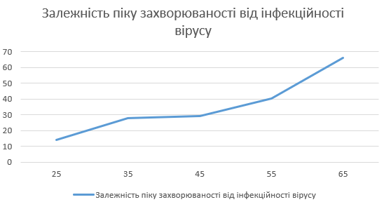
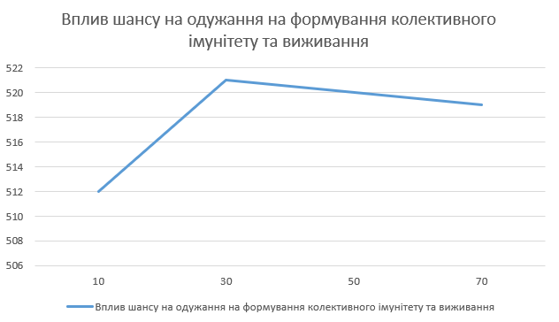
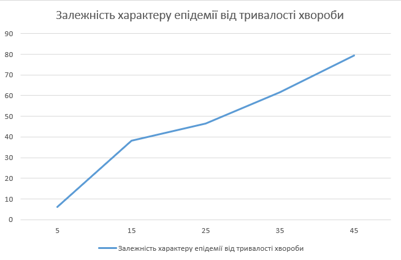

# Звіт з лабораторної роботи №1
**Тема:** Опис імітаційних моделей та проведення обчислювальних експериментів.
**Варіант:** 3 (Virus. Модель поширення захворювання у людській популяції).

## 1. Вербальний опис моделі
Модель імітує передачу та поширення вірусної інфекції в людській популяції. Кожна людина моделюється агентом, який випадково переміщується простором і може перебувати в одному з трьох станів: здоровий, хворий або імунний. Здорові агенти можуть заразитися при контакті з хворими, після чого вони хворіють протягом певного часу. Після закінчення цього часу вони або одужують і отримують імунітет, або помирають. Модель показує, як характеристики вірусу впливають на виживання популяції та формування колективного імунітету в умовах постійного природного оновлення населення.

Керуючі параметри:

- number-people - визначає початкову кількість агентів (людей) у середовищі моделювання під час старту симуляції
- infectiousness - визначає ймовірність того, що здорова людина заразиться вірусом під час контакту з хворим агентом (знаходження на одній клітинці).
- chance-recover - визначає ймовірність  успішного одужання хворого агента після закінчення терміну хвороби. Якщо одужання не відбувається, агент помирає.
- duration - визначає тривалість перебігу хвороби, протягом якої інфікований агент залишається заразним для оточуючих.

**Внутрішні параметри:**

- Стан здоров'я агента. Кожен агент у будь-який момент часу є або здоровим, або хворим, або імунним - захищеним від повторного зараження.
- Вік агента. Кожна людина в моделі має вік та природну тривалість життя. Коли вік досягає максимуму, агент вмирає від старості, звільняючи місце для народження нових агентів.

**Показники роботи системи:**
- %infected — поточний відсоток інфікованих (хворих) агентів від загальної чисельності популяції.
- %immune — поточний відсоток агентів, які успішно перехворіли та отримали імунітет.
- years — модельний час (у роках), що минув від початку симуляції.
- Загальна чисельність популяції  та кількість людей у кожному зі станів, що динамічно відстежуються на графіку "Populations".

**Примітки:** При високих показниках тривалості хвороби вірус може ніколи не зникнути повністю, стаючи ендемічним, оскільки він постійно знаходитиме нових вразливих агентів серед тих, що щойно народилися.

**Недоліки моделі:** Переміщення агентів відбувається абсолютно хаотично і не відображає реальні соціальні зв'язки чи регулярні маршрути людей. Зараження можливе лише за умови ідеального збігу координат, без урахування радіусу поширення вірусу повітряним шляхом. Також модель не передбачає можливості введення карантинних обмежень, ізоляції або вакцинації для боротьби з епідемією.
## 2. Обчислювальні експерименти

### Эксперемент 1. Залежність піку захворюваності від інфекційності вірусу
Досліджується, як зміна показника `infectiousness` (ймовірність зараження) впливає на максимальний відсоток хворих у популяції. 
Початкові умови:
- number-people: 150
- chance-recover: 55%
- duration: 25 weeks
Тривалість одного тесту: 5 років.

| Інфекційніст infectiousness | Максимум infected % | Приблизний час досягнення піку (weeks) |
| --------------------------- | ------------------- | -------------------------------------- |
| 25                          | 14.2                | 235                                    |
| 35                          | 28                  | 260                                    |
| 45                          | 29.3                | 195                                    |
| 55                          | 40.2                | 215                                    |
| 65                          | 66                  | 160                                    |

Зі збільшенням параметра інфекційності від 25 до 65 максимальний відсоток хворих у популяції суттєво зростає - з 14.2% до 66%. Також, час досягнення піку захворюваності загалом скорочується, досягаючи найшвидшого показника у 160 тижнів при максимальній дослідженій інфекційності. Вища заразність вірусу призводить до значно масштабнішого та стрімкішого спалаху епідемії.

### Експеримент 2. Вплив шансу на одужання на формування колективного імунітету та виживання
Досліджується, як параметр `chance-recover` впливає на кількість людей з імунітетом та загальний розмір популяції (`total` на графіку). 
Початкові умови:
- number-people: 150
- infectiousness: 65%
- duration: 25 weeks
Тривалість одного тесту: 10 років

| Шанс на одужання | Фінальний розмір популяції |
| ---------------- | -------------------------- |
| 10               | 512                        |
| 30               | 521                        |
| 50               | 520                        |
| 70               | 519                        |
| 90               | 519                        |
Графік:

Зміна шансу на одужання від 10% до 90% практично не впливає на фінальний розмір популяції. У всіх проведених тестах кінцева кількість людей залишається стабільною, коливаючись у дуже вузьких межах - від 512 до 521 особи. Це свідчить про те, що за заданих умов природне народження нових агентів повністю компенсує втрати від вірусу, дозволяючи популяції відновлюватися та підтримувати стабільну чисельність незалежно від рівня смертності.

### Експеримент 3. Залежність характеру епідемії від тривалості хвороби
Початкові умови:
- number-people: 150
- infectiousness: 65%
- chance-recover: 75 %
Тривалість одного тесту: 5 років.

| Тривалість хвороби duration | Максимальний %infected | Чи зник вірус до кінця симуляції? |
| --------------------------- | ---------------------- | --------------------------------- |
| 5                           | 6.1                    | Так                               |
| 15                          | 38.1                   | Ні                                |
| 25                          | 46.5                   | Ні                                |
| 35                          | 61.6                   | Ні                                |
| 45                          | 79.3                   | Ні                                |
Графік:

Зі збільшенням тривалості хвороби максимальний відсоток інфікованих у популяції стрімко зростає: від 6.1% при тривалості 5 тижнів до 79.3% при тривалості 45 тижнів. За умови короткої тривалості в 5 тижнів вірус не встигає масово поширитися і повністю зникає до кінця симуляції. Однак при тривалості хвороби 15 тижнів і більше кожен інфікований має достатньо часу, щоб передати вірус іншим, через що епідемія стає масштабнішою, а сам вірус не зникає та продовжує циркулювати в популяції протягом усього періоду спостереження.

